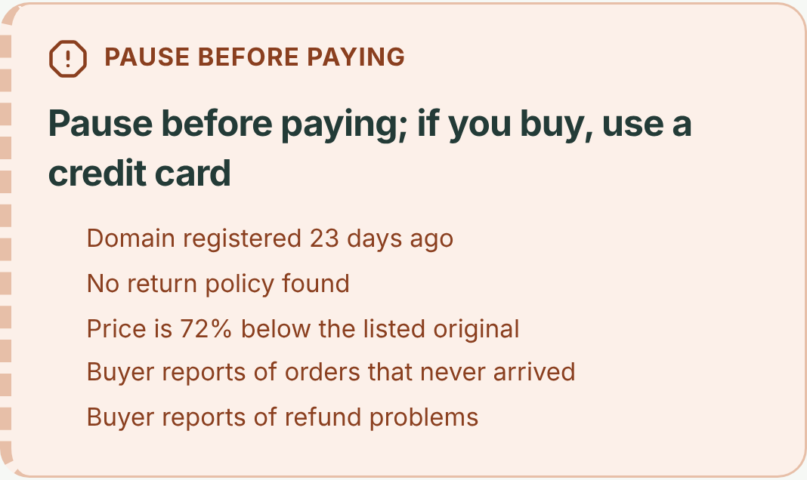
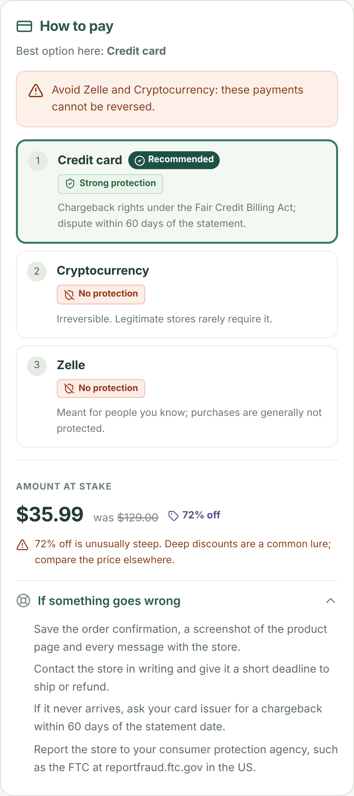

# CheckoutGuard

**A little clarity before checkout.**

CheckoutGuard is a Chrome side panel for the moment right before you pay a store you've never heard of. Click **Check this store** and it answers two questions:

1. **What does the public evidence say about this store?** Real buyer reports on Reddit and Instagram, how long the domain has existed, whether the page has a return policy and contact details, how steep the discount is, and whether the store's own reviews read as AI-written.
2. **If I still want it, how should I pay?** It reads which payment methods the page actually offers and ranks them by how well they protect your money: a credit card's chargeback rights versus a Zelle or crypto payment that can't be reversed. It also tells you what to do if the order never shows up.

You get one of three verdicts, **Proceed**, **Protect your payment**, or **Pause before paying**, with the reasons behind it. CheckoutGuard never calls a store "safe". It shows what the evidence says and how much of it there is.

<p align="center">
  
  
</p>

> 🎬 Demo video: [`showcase/checkoutguard-demo.mp4`](showcase/checkoutguard-demo.mp4). The voice-over script is in [`showcase/VOICEOVER.md`](showcase/VOICEOVER.md).

## What's in the panel

| Section | What it shows |
| --- | --- |
| **Decision** | Proceed / Protect your payment / Pause, a one-line headline, and up to five reasons, each taken from a specific finding. |
| **How to pay** | The payment methods this page offers, ranked strong → moderate → limited → none, with a recommended method and a warning when irreversible methods are listed. |
| **Amount at stake** | Price, the "was" price, and the discount. Discounts of 70% or more get flagged. |
| **If something goes wrong** | 3–5 dispute steps that fit the recommended payment method. |
| **Risk index + coverage** | A 0–100 heuristic computed by plain code, plus how much of the evidence actually came back. |
| **Evidence** | Reddit, Instagram, store basics (domain age, policy, contact, pricing), and the review-text check. Every quote links to its source. |
| **Summary** | A 2–3 sentence brief. When `ANTHROPIC_API_KEY` is set, Claude writes it from the evidence alone; otherwise a built-in template does. |
| **Recent checks** | Your last five checks (domain, verdict, risk, time only), kept on this device. |

## Quick start

You need Node 22+, Python 3.11+, [uv](https://docs.astral.sh/uv/), and Chrome.

```sh
make install     # uv sync, creates backend/.env, npm install
make backend     # API on http://127.0.0.1:8000  (leave running)
make extension   # builds extension/.output/chrome-mv3
```

Load it in Chrome:

1. Go to `chrome://extensions` and turn on **Developer mode**.
2. Click **Load unpacked** and pick `extension/.output/chrome-mv3`.
3. Pin CheckoutGuard, open a product page, click the toolbar icon, then **Check this store**.

Clicking the icon gives the extension temporary access to that one tab. If you switch tabs, click it again.

**No API keys?** You still get the keyless checks (domain age and page signals) and full payment guidance. You can also pick **Try a fictional demo** in the panel, which uses invented merchants and is labeled as fictional everywhere. The backend still has to be running.

### Browser preview (no extension)

```sh
make preview     # open http://localhost:5173/preview.html
```

This is the same React UI and the same `/analyze` endpoint. The preview can't read tabs, so it opens in demo mode. Use `localhost`, not `127.0.0.1`, or CORS will block the API calls.

## API keys

Put these in `backend/.env` and restart the backend. Every key is optional. A missing key marks that source as unavailable; it never switches on demo mode.

| Variable | What it powers | Where to get it |
| --- | --- | --- |
| `BACKBOARD_API_KEY` | Reddit research (40% of the score) | [backboard.io](https://backboard.io) |
| `APIFY_TOKEN` | Instagram comment scan (30%). Actor runs are billed. | [Apify console](https://console.apify.com/settings/integrations) |
| `GPTZERO_API_KEY` | AI-text check on store reviews (10%) | [GPTZero API docs](https://docs.gptzero.me/api-reference/) |
| `ANTHROPIC_API_KEY` | Claude-written summary (never affects the score) | [Claude Console](https://platform.claude.com/) |

The **store** source (20%) needs no key. It uses public RDAP registration records and the signals read from the page.

Other settings:

| Variable | Default | Notes |
| --- | --- | --- |
| `CORS_ORIGINS` | `http://localhost:3000,http://localhost:5173` | Exact origins, comma separated |
| `EXTENSION_ID` | empty | The 32-char ID from `chrome://extensions`, for exact-origin CORS |
| `PROVIDER_TIMEOUT` | `45` | Seconds per source (1–50) |
| `CACHE_TTL` | `900` | Seconds (1–3600) |

The extension reads `WXT_API_URL` from `extension/.env` at build time (default `http://localhost:8000`). Rebuild after changing it. Keys never go in the extension.

## How it works

```text
product page ──click──▶ extractor (content script)
                          │  title, review text, linked Instagram profile,
                          │  payment badges, policy/contact links, price + "was" price
                          ▼
                     side panel ──POST /analyze──▶ FastAPI backend
                                                     ├─ Store      → RDAP domain age + page signals (keyless)
                                                     ├─ Backboard  → Reddit threads → each quote verified on the live page
                                                     ├─ Apify      → recent Instagram comments on the linked profile
                                                     └─ GPTZero    → AI-text signal on the store's own reviews
                                                     ▼
                                deterministic scoring → risk index, coverage, verdict
                                payment table         → ranked methods, dispute steps
                                Claude (optional)     → plain-language brief from the evidence only
```

- **Extraction** runs only when you click. Review adapters cover Judge.me, Loox, Yotpo, and structured generic reviews. Payment detection reads badge alt text, labels, and payment-related copy. It skips negations ("we do not accept PayPal") and ambiguous words outside a payment context. Unknown values are sent as `null`, never guessed. Checkout and account pages are refused, and query strings are stripped from URLs.
- **Providers** run concurrently, each with its own deadline, so one failing source doesn't take down the others. Results are cached in memory for 15 minutes. **Check again** reuses the cache; the refresh button skips it.
- **Scoring and payment guidance** are plain code (`backend/app/scoring.py`, `backend/app/payments.py`). No model decides the number or the verdict.
- **The AI layer** helps in two places: Backboard does the open-web Reddit research, and Claude rewrites the finished evidence into plain language. Claude gets only finding summaries, never raw review text, and is told to add no new facts and never to call a store safe. If the call fails, times out, or is declined, the panel shows the template summary instead.

## Reading the result

### Verdict

- **Pause** if the risk index is 60 or higher, the domain is under 30 days old, or the store only accepts payment methods with no buyer protection.
- **Protect your payment** if evidence is limited, the risk index is 30 or higher, or any store-level concern shows up.
- **Proceed** otherwise. This means fewer concerns, not a guarantee.

### Payment protection tiers

| Tier | Methods | Why |
| --- | --- | --- |
| Strong | Credit card; PayPal (goods & services); Apple Pay / Google Pay / Shop Pay / Amazon Pay backed by a credit card | Chargeback rights (Fair Credit Billing Act) or a purchase-protection program |
| Moderate | Debit card; Klarna, Afterpay, Affirm | You can dispute, but the money is already out of your account, or you keep owing installments during the review |
| Limited | Bank transfer | Hard to recall once sent |
| None | Zelle, wire, crypto, gift cards, Cash App, Venmo (friends & family), Western Union | Effectively irreversible. Legitimate stores rarely require these. |

This is general consumer information, not legal or financial advice. Card issuers and payment providers set their own terms.

### Risk index

The **risk index (0–100)** is a heuristic, not a probability that the store is a scam. Nobody has validated it against real outcomes yet.

- Weights: Reddit 40%, Instagram 30%, store 20%, review text 10%. When some sources don't respond, the weights of those that do are rescaled to add up to 100%.
- **Coverage** is the share of the total weight that returned usable data. Under 60% shows a **Limited evidence** banner, even when the score is low. With no sources at all, the score is `—` and coverage is 0%.
- Reddit/Instagram: each distinct verified complaint adds 25 points, up to 85. Repetitive Instagram comments can add 5.
- Store: domain under 30 days +45, under 180 days +30, under a year +15. No return policy +10. No contact details at all +10. Discount of 70% or more +15. Only unprotected payment methods +30. Capped at 85.
- GPTZero contributes at most 20 points, so on its own it can never produce a high-risk result. AI-written reviews aren't proof of fraud.
- A Reddit source counts only when two separate threads have supporting text found on the page. Instagram needs at least five readable comments and two real experiences. Unverified citations are still shown, but they don't count toward the score.

"Source text checked" means the quoted wording exists at that URL. It doesn't mean the claim is true. Domain age comes from public registration records, and an old domain can still change hands.

## API

```sh
curl http://localhost:8000/health
curl -X POST http://localhost:8000/analyze -H 'Content-Type: application/json' \
  -d '{"url":"https://lunar-outlet.example/products/travel-pack","demo":"warning"}'
```

Demo scenarios: `warning` (Pause), `positive` (Proceed), `limited` (Protect, no evidence), `outage` (Protect, partial evidence). Leave out `demo` for a live scan:

```json
{
  "url": "https://merchant.example/products/bag",
  "productTitle": "Everyday travel pack",
  "instagramLinks": ["https://www.instagram.com/merchant/"],
  "reviews": ["Original review wording."],
  "pageSignals": {
    "paymentMethods": ["credit-card", "paypal", "zelle"],
    "hasReturnPolicy": true,
    "hasContactPage": true,
    "hasEmail": null,
    "hasPhone": null,
    "price": 35.99,
    "compareAtPrice": 129,
    "currency": "USD"
  },
  "extractionLimitations": [],
  "refresh": false
}
```

Every field except `url` is optional. The response adds `decision`, `payment`, `amountAtStake`, and `brief` to the per-source evidence. Request limits: 100 KB per request, 20 reviews, 2,000 characters per review, 12,000 characters in total. Swagger is at `/docs`.

## Development

```sh
make test      # pytest + ruff, then vitest, tsc, eslint, prettier, WXT build
make format
```

As of 2026-10-25, 91 backend tests and 44 extension tests pass, and typecheck, lint, format, and the WXT build are clean. Details are in [docs/VALIDATION.md](docs/VALIDATION.md).

```text
backend/app/
  main.py, settings.py      HTTP boundary, env config
  models.py                 Pydantic contracts, URL validation, page signals
  service.py, cache.py      async orchestration, TTL cache
  scoring.py                pure scoring, store score, verdict rules
  payments.py               protection tiers, ranking, dispute steps
  brief.py                  optional Claude summary with template fallback
  demo.py                   fictional fixtures
  providers/                RDAP store check, Backboard/Reddit, Apify/Instagram, GPTZero, citation security
extension/
  entrypoints/              background worker, extractor content script, React side panel
  entrypoints/sidepanel/components/   decision banner, payment card, brief, recent checks
  lib/                      DOM adapters + page signals, Chrome boundary, Zod contracts
  tests/                    DOM fixtures, panel behavior tests
showcase/                   launch video, scenes, render script, voice-over
docs/                       architecture, providers, validation
```

## Known gaps

- Live provider calls with real keys haven't been tested yet, and that includes the Claude summary, which so far has only run against a fake client.
- The extension hasn't been tested end to end in Chrome. The panel has been rendered and checked at 400 px in the browser preview.
- Review and payment adapters are tested on synthetic fixtures, not live stores. Cross-origin widgets like some Loox iframes can't be read, and payment badges drawn as unlabeled images aren't detected.
- RDAP coverage varies by top-level domain. Some registries don't publish registration dates.
- The backend has no auth or rate limiting. Keep it on localhost.
- Not built yet: Trustpilot, more review widgets, finding Instagram accounts the store doesn't link, and AI-image detection.
