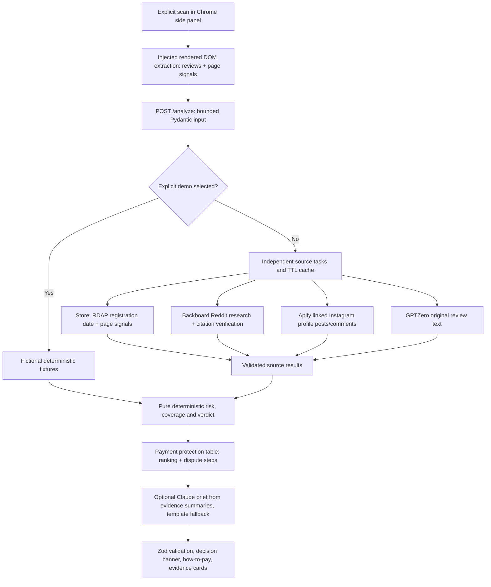

# Architecture and trust boundaries

No LLM assigns the risk score, the verdict, or the payment ranking. Candidate quotes are untrusted data, validated and checked before deterministic scoring. No provider instructions are executed. Frontend uses React text escaping and HTTP(S)-validated links, never raw HTML.

The extension reads only on explicit scan. No cookies, forms, account information, payment fields, or browsing-history APIs are accessed. The tab query is restricted to the active tab in the current window. It uses activeTab, scripting, sidePanel and storage permissions, read access to http(s) pages (so a scan works without a toolbar click), and a single backend-origin host permission. Nothing runs on a page until you press Check this store: the content script is injected programmatically on that click only. URL query strings and fragments are removed before transmission. Typical checkout/cart/account/login/payment routes are refused. This is a route heuristic, not a universal proof that every possible URL is public; users should scan public storefront pages only.

A source task has a deadline including queue wait. At most six provider tasks run concurrently in each process. Errors do not cancel siblings. Client cancellation suppresses stale UI results; it does not promise to cancel an already-started paid actor run. Apify gets its own 35-second run timeout. GPTZero retries once only on transient network/rate-limit/gateway errors. Backboard and actor-start requests are not automatically replayed.

Citation fetching is restricted to HTTPS Reddit discussion paths. No user-selected merchant pages are backend-fetched. Every DNS answer is checked for a globally routable address; connection is pinned to a validated address with the original hostname used for TLS verification. Redirects are refused, never followed. Content type, response size, and socket timeouts are bounded. HTML script/style content is excluded. Verification requires a substantial exact quotation and an exact domain near it. This can produce false negatives, especially when Reddit blocks unauthenticated readers; such text stays unverified and does not count toward source availability. Exact quote presence does not verify the truth of allegations.

Provider API origins are fixed constants, HTTP proxy inheritance is disabled for HTTPX, and redirects are disabled. Instagram returned URLs and owner handles are checked against the directly linked profile. Merchant association is based on a storefront link, not a verified legal-entity identity.

Cache keys use SHA-256 of source + merchant host, with profile links added for Instagram and URL + complete review sample added for GPTZero. This prevents different products or changed samples sharing review analysis. Keys never store raw review text. Cached results contain excerpts where necessary; they are memory-only, bounded to 256 entries and a maximum one-hour TTL. Error/unavailable sources are not cached. Research domains are exact host identities with only `www.` stripped; unrelated subdomains are not automatically combined. Demo fixtures bypass cache entirely.

The supplied API is a local development service. Production requires an authenticated gateway, rate limits, worker limits, HTTPS, egress restrictions, and exact origin configuration. CORS does not protect an API from non-browser clients. Configure gateway body limits and timeouts too. Use `--no-access-log`; the app does not log payloads or provider exceptions. Do not add raw provider-response logging during debugging.

## Store source and payment guidance

The store source needs no key. The backend derives the registrable domain from the scanned URL and asks `rdap.org` for its RDAP record. Only HTTPS redirects to an RDAP server are followed, and the response size and time are bounded. The only value it uses is the `registration` event date. Page signals (payment methods, policy/contact presence, price and "was" price) come from the extension as booleans, enums, and numbers. They are never free text, and `null` means unknown, never "missing". No merchant page is fetched by the backend.

`payments.py` is a static table that maps each payment method to a protection tier, a note, and dispute steps. The ranking, the recommended method, and the irreversible-method warning are computed from that table and the methods the page lists. If the page lists no methods, the panel shows a general ranking.

## AI brief

When `ANTHROPIC_API_KEY` is set, `brief.py` makes one Messages API call (`claude-opus-5-5`, low effort, 8-second timeout, no retries). The input is a JSON summary of the computed evidence: findings (titles and short excerpts), coverage, verdict, and payment ranking. The system prompt treats that JSON as untrusted data and forbids adding facts or calling a store safe. Raw review text, page text, and URLs from the request are never sent. Any stop reason other than `end_turn`, and any exception or timeout, falls back to the deterministic template. The brief is computed after scoring, so it can't change the score or the verdict. Demo mode always uses the template.

## Recent checks

The panel keeps the last five results in `chrome.storage.local`: domain, verdict, risk, and timestamp. It stores no review text, evidence, or URLs, and nothing is synced. In browser preview it falls back to `localStorage`, or to memory if storage is blocked.
